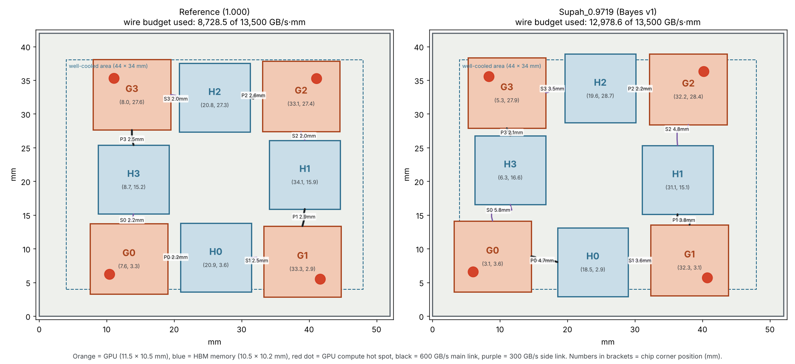
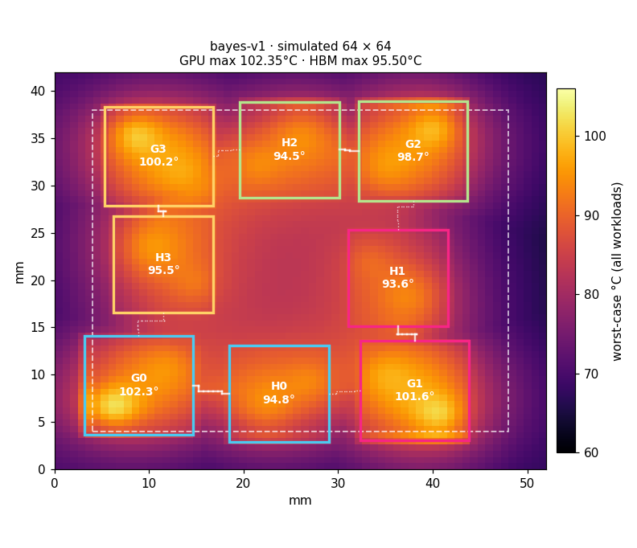

# Supah_0.9719 — Bayes v1

Found by Zaiba's Bayesian-optimization search (`simulation/tools/bayes.py`, 70 tests, seed 11) starting from Supah v1.
Five dies moved (G0, H0, G2, H2, H3); G1, G3 and H1 stayed. Source folder: `simulation/layouts/bayes-v1/`.

## Official score (organizers' pinned Linux HotSpot binary, sha256 5c3fcad8…)

| Grid | Score | Hottest GPU | Hottest HBM |
|---|---|---|---|
| 64 × 64 | **0.97185576** | 102.35 °C | 95.50 °C |
| 128 × 128 (finals) | native estimate 0.974668, pinned-binary check pending | 102.72 °C | 95.52 °C |

The 64-grid number matches the native Apple Silicon estimate in `simulation/layouts/bayes-v1/estimate-64.json` to every digit.

What sets the score: G0 in skewed_compute (102.35 °C) on the GPU side; on the HBM side, memory_stream, where all four
HBM stacks sit between 93.6 and 95.5 °C (H3 and G3 both at 95.5). Wire use 12,978.6 of 13,500 GB/s·mm.

## Coordinates (mm, lower-left corner of each die, no rotation)

| Die | x | y |
|---|---|---|
| G0 | 3.150 | 3.621 |
| H0 | 18.511 | 2.920 |
| G1 | 32.346 | 3.052 |
| H1 | 31.066 | 15.107 |
| G2 | 32.166 | 28.414 |
| H2 | 19.613 | 28.687 |
| G3 | 5.265 | 27.871 |
| H3 | 6.270 | 16.565 |

