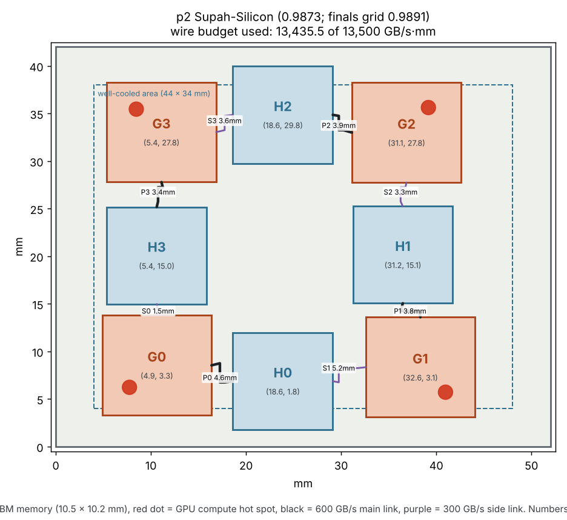

# Supah_0.9873

Our best design so far: official score **0.9873** on the routine 64 × 64 grid and **0.9891** on the 128 × 128 finals grid (lower is better; 1.0000 is the organizers' reference).

| Grid | Score | Hottest GPU | Hottest HBM | Reference GPU / HBM |
|---|---|---|---|---|
| 64 × 64 (routine) | **0.9873** | 103.58 °C | 95.17 °C | 104.59 / 97.68 °C |
| 128 × 128 (finals) | **0.9891** | 103.87 °C | 95.09 °C | 104.74 / 97.70 °C |

**What it does:** spreads the GPUs toward the outer corners and moves the two middle memory stacks to the top and bottom edges, so each hot GPU has more room. The price is longer wires: it uses 13,435.5 of the 13,500 GB/s·mm wire budget.

**How it was found:** the second simulated-annealing search, 45 tests scored with the exact GPU check (official 64 × 64 grid, the two GPU-deciding workloads), starting from `Supah_0.9987`.

## Chip positions (lower-left corner of each die)

| Die | x (mm) | y (mm) |
|---|---|---|
| G0 | 4.869 | 3.289 |
| G1 | 32.573 | 3.089 |
| G2 | 31.122 | 27.751 |
| G3 | 5.356 | 27.792 |
| H0 | 18.619 | 1.773 |
| H1 | 31.232 | 15.059 |
| H2 | 18.619 | 29.757 |
| H3 | 5.360 | 14.975 |

## Files

| File | What it is |
|---|---|
| `submission.json` | The layout, ready to submit to the challenge |
| `official_report_64x64.json` | Official signed scorer report, routine grid |
| `official_report_128x128_finals.json` | Official signed scorer report, finals grid |
| `floorplan.png` | Where every chip sits, with the routed wires |
| `heatmap.png` | Worst-case temperature over all five workloads (fast 32 × 32 preview) |
| `Supah-Silicon_Full_Workings.docx` | The full write-up: every design, result and calculation |

Re-check it yourself: `bash simulation/run.sh Models/Supah_0.9873/submission.json`
