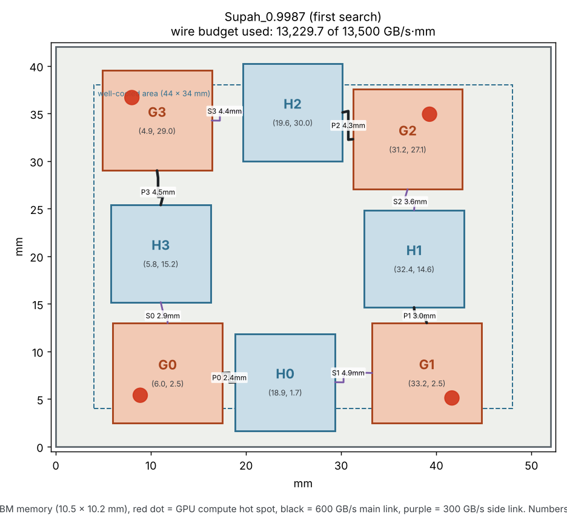

# Supah_0.9987

Our first design below the reference: official score **0.9987** on the 64 × 64 grid (lower is better; 1.0000 is the organizers' reference). It was the starting point for `Supah_0.9873`.

| Grid | Score | Hottest GPU | Hottest HBM | Reference GPU / HBM |
|---|---|---|---|---|
| 64 × 64 (routine) | **0.9987** | 104.49 °C | 96.12 °C | 104.59 / 97.68 °C |

**How it was found:** the first simulated-annealing search, 150 tests scored with the fast 16 × 16 estimate, starting from the organizers' reference. The fast estimate promised 0.958; the official score was 0.9987. That gap is why later searches used the exact GPU check.

## Chip positions (lower-left corner of each die)

| Die | x (mm) | y (mm) |
|---|---|---|
| G0 | 6.001 | 2.455 |
| G1 | 33.248 | 2.485 |
| G2 | 31.240 | 27.052 |
| G3 | 4.892 | 29.010 |
| H0 | 18.861 | 1.664 |
| H1 | 32.413 | 14.627 |
| H2 | 19.646 | 30.013 |
| H3 | 5.777 | 15.179 |

## Files

| File | What it is |
|---|---|
| `submission.json` | The layout, ready to submit to the challenge |
| `official_report_64x64.json` | Official signed scorer report, routine grid |
| `floorplan.png` | Where every chip sits, with the routed wires |
| `heatmap.png` | Worst-case temperature over all five workloads (fast 32 × 32 preview) |
