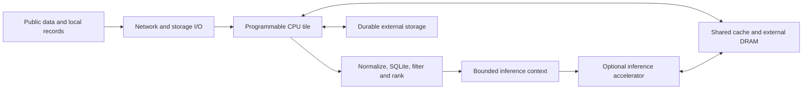

# Supah Edge v0

**A CPU-centered, shared-memory SoC architecture hypothesis, with an optional
inference accelerator.** The first target is the measured Muni data-to-context
pipeline. The inference tile will be specified after a local model is chosen
and profiled.

This is an architecture proposal and an executable sizing model. It does not
include RTL, synthesis, a process-node choice or fabrication-ready floorplans.

## What the profile supports

The current workload executes Ruby, SQLite, structured ranking and empirical
statistical prediction on the CPU. It creates hundreds of thousands of Ruby
objects during normalization and persistence. A 100-row indexed query takes
about 3.37 ms; an empirical 311 prediction takes about 0.42 ms. Building context
from the larger dataset takes about 198 ms. These results favor retaining a
programmable CPU and an efficient memory/data layout as the initial platform.
They do not prove whether execution units, cache misses, memory stalls or
software overhead dominate inside each stage; that needs hardware counters.

The existing bulk-write API is 2.22× faster for service-request inserts and
2.58× for permit inserts in this replay. Muni's Beat path already batches;
its Get Runner can persist records individually. This is an API comparison,
not a newly applied production speedup. Fix software/data layout before
committing an expensive hardware interface to a slow software path.

JSON decoding takes only 1.15% and 4.36% of the two bulk-ingestion pipelines
when isolated stage medians are added. Even an infinitely fast JSON decoder
would therefore yield only about 1.012× and 1.046× pipeline speedup under
Amdahl's assumptions. A standalone JSON accelerator is a weak first target.
Normalization has a larger measured share, but a hardware offload must first
beat a software implementation after transfer, batching and integration costs.

## Component decisions

| Component | Initial decision | Evidence required to size it |
|---|---|---|
| CPU | Programmable 64-bit cores; retain normal Ruby/SQLite/OS support | Concurrent workload, CPU/cache counters, actual deadlines |
| Shared memory | Coherent cache plus external DRAM; favor reuse of normalized records and bounded contexts | Resident working set, cache misses, measured memory traffic |
| Storage/network | Standard interfaces and DMA; persistent records remain in external storage | Sustained I/O and durability/recovery measurements |
| Inference | Optional programmable NPU/GPU interface | Chosen model, precision, weights, KV cache, throughput, quality and energy |
| Specialized logic | Prototype normalization, tokenization or batched filtering before RTL | End-to-end gain at unchanged outputs and measured energy |
| Package | Evaluate a conventional shared-memory SoC first; consider 2.5D when measured bandwidth/capacity warrants it | Physical IP, interconnect, power, thermal and cost models |

The sample database plus WAL occupied about 16.4 MB at the recorded point.
That is neither the full application's working set nor a production memory
requirement. HBM capacity, memory bandwidth and NPU TOPS remain unspecified.
The four-GPU/four-HBM package used by Track 2 is a thermal benchmark constraint;
it is not evidence that a municipal deployment needs four GPUs.

## Executable design inputs

[`supah-edge-v0.json`](supah-edge-v0.json) is generated by
[`profiling/design.py`](../profiling/design.py) from the checked-in profile.
It includes a hash of the exact measurement file and keeps measurements,
scenario assumptions and unmeasured hardware properties distinct.

For the illustrative mix of 100 311 rows/s, 100 permit rows/s, 10 queries/s,
10 empirical predictions/s and one digest context every 10 seconds, the sum
of reference-host CPU demand is about **0.071 CPU-seconds per second**. At a
60% utilization target that is **0.118 reference-host core equivalents**.
This is a lower-bound sizing calculation on this small dataset, not a
one-core appliance specification. Full analytics refresh, model execution,
queues, I/O, concurrency and redundancy are excluded. Change the explicit
rates and rerun the model to explore another workload mix.

## Next implementation gates

1. Benchmark production-scale snapshots and concurrent requests, including
   cold caches. Add CPU/cache/DRAM counters and whole-system energy measurement.
2. Evaluate columnar batches, projected queries and versioned context reuse.
   Preserve output correctness. Identify a stable kernel worth accelerating.
3. Select a local inference model and measure prefill, decode, context length,
   KV-cache growth, quantization quality, time-to-first-token and energy/task.
4. Define the chosen kernel's input/output and memory interface, validate it
   in software and FPGA/RTL simulation, then obtain synthesis area/timing.
5. Use calibrated component power traces for a separate Supah thermal study.
   Carry measured system throughput and power into Track 1 deployment sizing.

The current [`Supah Silicon v1`](../simulation/layouts/supah-v1/README.md)
package remains the verified Track 2 artifact. No benchmark score is changed
by this architecture proposal.

## Measurement references

Operational intensity requires operations per byte of actual memory traffic,
which this Ruby replay does not measure. See the original
[Berkeley Roofline report](https://www2.eecs.berkeley.edu/Pubs/TechRpts/2008/EECS-2008-134.pdf).
For the later inference-energy study, measure the defined system and workload
together; the [MLPerf Inference power rules](https://github.com/mlcommons/inference_policies/blob/master/power_measurement.adoc)
provide a useful methodology reference. This project is not an MLPerf submission.
