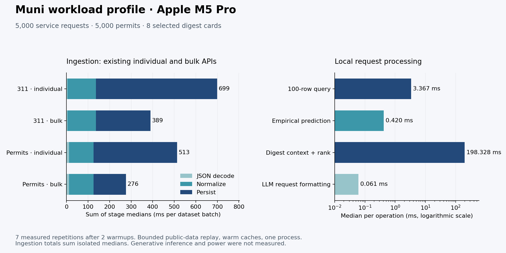

# Measured Muni workload results

The harness executed Muni's current code on an Apple M5 Pro with Ruby 3.3.6.
The application database was empty, so this is a bounded public-data replay,
not a production-traffic profile. Both sizes use the same captured corpus:
1,000 or 5,000 records **per municipal table**, plus one city-news item and 60
calendar items. Muni selected eight digest cards. Inputs and loaded source
files are identified by hashes in each report.

## Local processing timings

Values are median milliseconds. Batch rows refer to the whole 1,000- or
5,000-row dataset; query and prediction rows are per operation, derived from
repeated loops. Seven repetitions follow two warmups. The reports contain
all raw timing samples, CPU time, allocation counts and descriptive p95.

| Operation | 1,000-row datasets (ms) | 5,000-row datasets (ms) |
|---|---:|---:|
| 311 normalization, whole sample | 23.059 | 131.419 |
| 311 individual inserts, whole sample | 117.799 | 562.991 |
| 311 bulk inserts, whole sample | 48.049 | 253.218 |
| Permit normalization, whole sample | 20.469 | 113.781 |
| Permit individual inserts, whole sample | 84.038 | 387.521 |
| Permit bulk inserts, whole sample | 32.311 | 150.170 |
| 311 statistical-model training | 28.781 | 167.771 |
| Permit statistical-model training | 24.987 | 130.876 |
| One indexed query returning 100 rows | 3.751 | 3.367 |
| One empirical 311 prediction | 0.191 | 0.420 |
| One digest context/ranking pass | 85.284 | 198.328 |
| One LLM request formatting pass | 0.041 | 0.061 |

The query returns the same 100 rows at either size; these small differences
are not evidence of a scaling law. Its query plan uses the `(hall, opened_at)`
index. Training uses 4,079 eligible 311 records and 4,863 eligible permits in
the larger sample. All 1,000 local predictions per repetition returned ready
results. This inference is Muni's empirical statistical model, not an LLM.

The larger digest context reduces 61 civic candidates to eight cards and
produces an 8,214-byte Anthropic request body. Payload size is not a token
count, working-set size or DRAM-traffic measurement. Generative inference
was skipped at the user's request; no API key or model call is required.

## Implications for the chip

- The existing bulk-write API is **2.22× faster** for 311 insertion and
  **2.58× faster** for permit insertion in the larger replay. Beats already
  use batching; Get Runner's persistence path uses individual writes. No
  Muni application code was changed to obtain this comparison.
- Summing isolated decode, normalize and insert medians suggests **1.80×**
  and **1.86×** ingestion improvement when switching from individual to bulk
  writes. Those sums are estimates, not separately measured end-to-end runs.
- JSON decode is a small share of that pipeline. An infinitely fast decoder
  would have an upper bound of about **1.012× / 1.046×** on the two bulk
  pipelines if all other work stayed fixed. Specialized JSON logic is a
  weaker first target than software batching and normalization/context work.
- CPU time is close to wall time in most stages. This establishes sustained
  process activity; it does not distinguish compute from memory stalls.
  Hardware counters are needed before calling the workload memory-bound.

The resulting [Supah Edge v0 architecture](../architecture/README.md) starts
with programmable CPU execution and shared memory, and reserves an optional
inference accelerator pending local-model measurements. Chip power, area,
TOPS, SRAM size and DRAM bandwidth are intentionally unspecified.

## Evidence and limits

- [5,000-row measured profile](results/cambridge-5000.json)
- [1,000-row measured profile](results/cambridge-1000.json)
- [Generated architecture and capacity scenario](../architecture/supah-edge-v0.json)
- [Reproduction and test instructions](README.md)

Native host measurements used warm caches and a single Ruby process.
Background machine activity was not controlled, so this is an exploratory
profile. A sandboxed comparison was excluded because its execution conditions
differed from the host baseline. Neither dataset size establishes full-city
or concurrent-server capacity. Network fetch is timed separately from local
processing; external inference, cold-cache behavior, memory-bus traffic,
peak working set and whole-system energy remain unmeasured. Source samples
are cached locally and are not committed. No private application tables,
raw prompts or model responses are included in the published reports.
