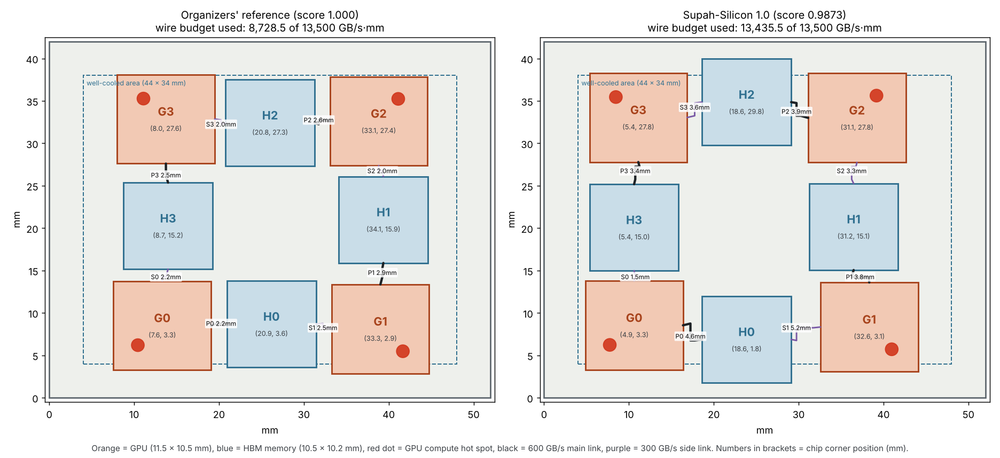

# Supah Silicon simulation

The current optimization method is described in
[Faster placement optimization](docs/08-surrogate-search.md), with the portable
verification workflow in [Supah design workflow](docs/07-supah-design-workflow.md). The earlier
Supah-Silicon experiments below are retained as design history.

**Current design: [Supah Silicon v2](layouts/supah-v2/README.md).** Official
AutoLab 64-grid score: **0.95991959**; GPU **101.40 °C**, HBM **94.16 °C**.
Ranked **#1 as charliemags** on the October 18 leaderboard, ahead of **0.96180425**.
The 0.95 and 0.94 targets were not reached. The design directory contains
the submission, signed report, local 64/128 verification, floorplan and search records.
The earlier
[v1 artifact](layouts/supah-v1/README.md) retains its Track 1 power export.

The original Supah-Silicon 1.0 experiment models four GPU dies and four HBM stacks with 3.6 TB/s of aggregate specified link bandwidth. Die power maps are fixed; positions and routes affect thermal coupling and modeled interconnect power. The link sum is not measured application throughput.

Built at Sundai @ MIT, Track 2 ("Design the coolest chiplet layout"), October 18, 2026.

## The chip

| | |
|---|---|
| Compute | 4 GPU dies, 11.5 × 10.5 mm each |
| Memory | 4 HBM stacks, 10.5 × 10.2 mm each |
| Interposer | 52 × 42 mm silicon |
| Links | 4 × 600 GB/s (each GPU to its own HBM) + 4 × 300 GB/s (each GPU to a neighbor's HBM) = 3.6 TB/s |
| Specified links per GPU | 600 + 300 GB/s; aggregate link capacity |
| Power | See each verification report's `total_w`, including modeled PHY and wire power |

The challenge fixes the dies, their power maps, the links and the cooler. What we design is where each piece of silicon sits.

## Earlier results (official scorer, 64 × 64 grid)

Score is the worse of the GPU and HBM peak temperature rises, relative to the organizer's reference layout. Lower is better; 1.0 is the reference.

| Layout | Score | Hottest GPU | Hottest HBM | What it is |
|---|---|---|---|---|
| Reference | 1.000 | 104.59 °C | 97.68 °C | Organizer's seeded layout |
| `layouts/v0` | 1.003 | 104.66 °C | 97.90 °C | Everything moved into the well-cooled area. Worse: dies ended up closer together. |
| `layouts/p1` | 0.9987 | 104.49 °C | 96.12 °C | First search (coarse-grid estimates) |
| `layouts/p2` | **0.9873** | **103.58 °C** | **95.17 °C** | Second search, exact GPU check |
| `layouts/r1` | not submitted | 108.01 °C | — | Hot spots turned to face the middle. Much worse; the middle collects heat from all four GPUs. |

What the physics rewards, so far:
- The GPUs set the score. In the compute-heavy workloads, each hot GPU mostly heats itself, so layout moves its peak by tenths of a degree, not degrees.
- Spacing between dies matters more than staying inside the well-cooled area.
- Each GPU's compute hot spot should point toward the outer edge, not toward the middle.

## The design

Supah-Silicon moves the two middle memory stacks to the top and bottom edges, shifts the left column of chips about 2.7 mm outward, and gives every GPU more room. The price is longer wires: 13,435.5 of the 13,500 GB/s·mm wire budget, against 8,728.5 for the reference. Draw any layout with `tools/floorplan.py`.

Raw logs of every test are in [`runs/`](runs/README.md).

## How we search

- `tools/fast.py` runs the organizer's own HotSpot build with the same heat sources on a coarser grid, for quick estimates. At 16 × 16 it takes about 2 s per layout but reads GPU peaks up to about 4 °C too cool. At 64 × 64 on only the two GPU-deciding workloads, it matches the official GPU number exactly in about 39 s.
- `tools/climb.py` is a simulated-annealing search over die positions, with optional soft guidance toward boxes proposed by an AI that reads heat maps (after "See it to Place it", VeoPlace).
- `tools/render.py` draws a layout as a worst-case heat map.
- Official numbers only ever come from the hill's scorer (`hills eval`), never from these tools.

## Supah-Silicon 2.0: a 3D what-if

`tools/stack3d.py` stacks each HBM on its GPU using the same HotSpot physics, workloads and cooler. It isn't scored by the challenge (the challenge is 2.5D only). Coarse 32 × 32 grid, assumed material values (listed in the file), so compare designs with each other rather than trusting absolute temperatures. Full sweep in `results3d/sweep32.json`.

| Design | Hottest GPU | Hottest HBM |
|---|---|---|
| 1.0 (2.5D, same grid) | ~103.6 °C | ~95.6 °C |
| Memory on top of GPU, best variant | 126.3 °C | 110.8 °C |
| GPU on top of memory, silicon fill, best variant | **110.5 °C** | **110.5 °C** |

Which die goes on top decides almost everything. Silicon fill around the stacks is the next lever. With the GPU on top, the bond type barely matters. Memory heat is the open 3D problem. Full plain-English write-up: [`docs/`](docs/README.md).

## Reproduce

1. Clone the organizer's simulator: `git clone https://github.com/Czaja107/chiplet-thermal-simulator`.
2. Point the tools at it: `export CRYO_HILL=/path/to/chiplet-thermal-simulator`.
3. Score a layout: `python3 $CRYO_HILL/verify_high_accuracy.py layouts/p1/submission.json --hotspot $CRYO_HILL/vendor/HotSpot/hotspot --grid 64`.

HotSpot is a pinned Linux x86-64 binary. Run `./simulation/run` from the repository root for Apple Silicon support through Docker; see the portable workflow linked above.

## Credits and sources

- Challenge, scorer and HotSpot build: [Czaja107/chiplet-thermal-simulator](https://github.com/Czaja107/chiplet-thermal-simulator)
- HotSpot thermal model: Skadron et al., ISCA 2003; Huang et al., IEEE Trans. Computers 2008
- AI-guided placement: "See it to Place it: Evolving Macro Placements with Vision-Language Models" (VeoPlace), ICML submission under review
- 3D stacking thermals: imec, IEDM 2025 ([IEEE Spectrum](https://spectrum.ieee.org/hbm-on-gpu-imec-iedm))
