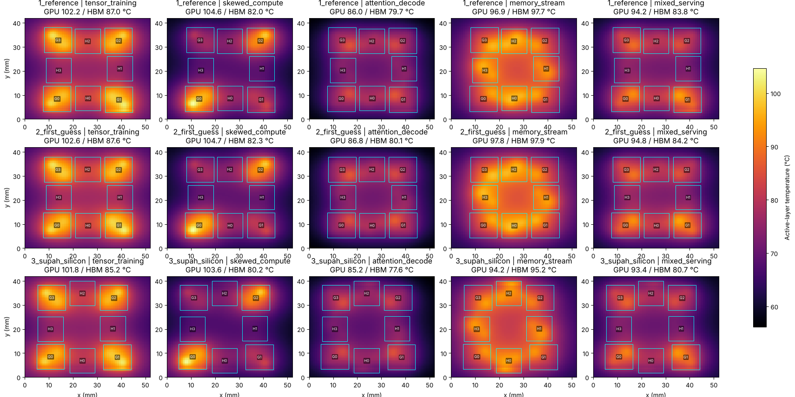
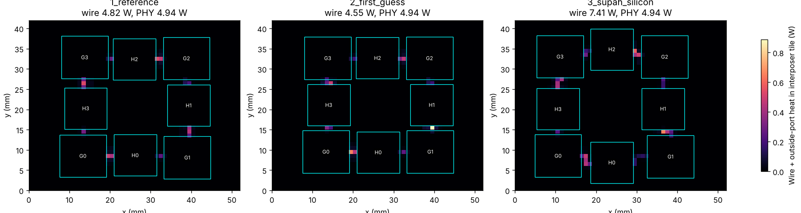

# The Supah-Silicon story

*How we laid out a four-GPU AI chip to run cooler, told in plain English. Every number here comes from the organizers' official simulator.*

---

## The setup: a hot kitchen

Picture a kitchen. The **chefs are GPUs**: they do the math. The **fridges are HBM memory stacks**: they hold the data. AI needs the fridges right next to the chefs, so modern AI chips put both on one slab of silicon, called an interposer. Supah-Silicon is one such slab: 52 × 42 mm, with 4 GPUs, 4 memory stacks and 3.6 TB/s of wiring between them.

The catch: busy chefs packed into a small kitchen get **hot**, and hot chips slow down. The challenge fixes the chips, the wiring rules and the cooler. The only thing we control is **where each chip sits**. The goal is to make the hottest GPU and the hottest memory stack as cool as possible, across five different workloads.

The organizers gave a starting layout, **the reference**: hottest GPU **104.59 °C**, hottest memory **97.68 °C**. That's a score of **1.0**. Lower wins.

## Chapter 1: Find the culprit

The simulator reports every chip in every workload, so we started there. The answer was clear:

- The hottest GPU is **G0 during `skewed_compute`**, when it draws 104 W, more than any other chip anywhere.
- The hottest memory is **H0 during `memory_stream`**, when memory runs flat out.

Both sat in the bottom row of the reference layout, partly hanging over the strip where the thermal paste conducts heat 8× worse.

## Chapter 2: The obvious fix fails

**Idea:** pull every chip fully inside the well-cooled area.

**Result: 1.003, slightly worse.** GPU 104.66 °C, memory 97.90 °C.

**Why:** fitting everything inside the cool zone squeezed the chips closer together, so they heated each other more. The extra crowding cancelled the better cooling. **Lesson one: spacing between chips matters more than the cooling strip.**

## Chapter 3: The simulator is slow, so we built faster ways to test

One official test takes about **94 seconds**. A search needs hundreds of tests. So we tried shortcuts:

- **A coarser grid** (slicing the chip into bigger blocks): 2 seconds per test, but it read the hottest GPU up to **4.4 °C too cool**, because it blurs the small hot spot. Our differences are tenths of a degree, so that's useless for ranking.
- **Only the two workloads that decide the GPU score**, at full detail: about **39 seconds**, and it matched the official GPU number **to 0.01 °C**. That became our workhorse.

**Lesson two: a fast test that's wrong is worse than a slow test that's right.**

## Chapter 4: Let a search do the walking

We used **simulated annealing**: start from a layout, nudge chips a little, keep the nudge if it's cooler (and sometimes even if it's a bit hotter, to escape dead ends), and take smaller steps as you go.

| Round | Score | Hottest GPU | Hottest memory |
|---|---|---|---|
| Reference | 1.000 | 104.59 °C | 97.68 °C |
| First search (coarse grid) | 0.9987 | 104.49 °C | 96.12 °C |
| **Second search (exact GPU check)** | **0.9873** | **103.58 °C** | **95.17 °C** |

The winning move: **spread the GPUs toward the outer corners** and slide the memory stacks to keep every wire legal and short enough.

Spreading out has a price. Longer wires make heat of their own: in the memory-heavy workload, Supah-Silicon's wires and link ports make 7.41 W of wire heat versus 4.82 W for the reference. It also uses **13,435 of the 13,500 GB/s·mm wire budget** the rules allow, so the GPUs can't spread much further.

*The test output: the organizers' own simulator, 64 × 64 grid. Rows are layouts (reference, first guess, Supah-Silicon), columns are the five workloads. Bright yellow is hot.*

*The trade-off: heat made by wires and link ports in the memory-heavy workload.*

## Chapter 5: The bold idea that backfired

Looking at the heat maps, we saw that each GPU's hottest corner points outward, toward the package edge. The middle of the package looked cool. **Idea:** turn the layout around so every GPU's hot corner faces the cool middle.

**Result: the GPU jumped to 108.0 °C.** The middle only *looked* cool; with all four hot corners aimed at it, it collected heat from every GPU at once. One test killed the idea. **Lesson three: point hot spots at open space, not at each other.**

## Chapter 6: What the physics rewards

1. **Give the hot GPUs room.** Spacing beats everything else, until the wire budget runs out.
2. **Let each hot spot face cool surroundings**, toward the edge rather than the crowd.
3. **The GPUs decide the score; the memory has slack.** Each hot GPU mostly heats itself, so every tenth of a degree takes real work.

## Chapter 7: What if we stacked it? (Supah-Silicon 2.0)

The challenge only scores flat layouts, but the industry is heading to 3D: memory stacked directly on the GPU. We built that with the same simulator, workloads and cooler.

- **Memory on top of the GPU:** the GPU hit as much as **197 °C** (about 150 °C in the more realistic setups). Its heat has to push through the memory to escape.
- **GPU on top of the memory:** best case **110.5 °C** GPU and 110.5 °C memory.
- Flat Supah-Silicon, for comparison: about 104 °C GPU.

**Lesson four: in 3D, which chip goes on top decides almost everything**, and memory heat becomes the new problem. That matches imec's research, presented at IEDM 2025.

## Epilogue: what's next

- Re-check the best layout on the finer **128 × 128 finalist grid**, as the organizers recommend for close results.
- **Hand-route wires** away from G0's hot corner (the scorer accepts custom wire paths).
- A **reduced-order model**: a math shortcut that would cut a 90-second test to about a millisecond, so the search can try millions of layouts.

---

**See it yourself:** [Run it and see it](docs/07-run-it-and-see-it.md), or one command in a GitHub Codespace: `bash simulation/run.sh`. **How the simulation works:** [the simulation docs](docs/README.md).
