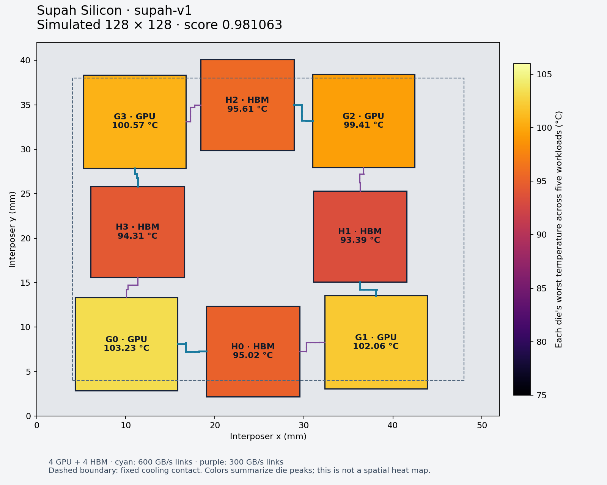

# Supah Silicon v1

A verified 2.5D package layout for the Track 2 simulator: four fixed GPU dies
and four fixed HBM stacks on a 52 × 42 mm interposer. This is a simulated
package design, not fabricated silicon or a new GPU/SoC microarchitecture.

## Result

At finalist resolution, the GPU peak is **0.64 °C lower than p2**.
The HBM peak changes by **+0.52 °C**. The normalized thermal score is
**0.81% lower than p2**. This is a thermal-score improvement, not
an equivalent reduction in energy, electricity cost or inference latency.

| Mesh | Design | Score ↓ | Worst GPU | Worst HBM |
|---|---|---:|---:|---:|
| 64 × 64 | Reference | 1.000000 | 104.59 °C | 97.68 °C |
| 64 × 64 | p2 | 0.987310 | 103.58 °C | 95.17 °C |
| 64 × 64 | Supah v1 | **0.981153** | **103.09 °C** | 95.56 °C |
| 128 × 128 | Reference | 1.000000 | 104.74 °C | 97.70 °C |
| 128 × 128 | p2 | 0.989090 | 103.87 °C | 95.09 °C |
| 128 × 128 | Supah v1 | **0.981063** | **103.23 °C** | 95.61 °C |

Score is `max((GPU_peak − 25)/(reference_GPU − 25), (HBM_peak − 25)/(reference_HBM − 25))`.
Each peak is the maximum across all five official workloads. Only compare
scores and temperatures at the same mesh. The 64-grid p2 row comes from its
existing signed report; the 128-grid p2 comparison was run for this experiment.
The new reports use the unmodified organizer judge and hash-verified Linux
HotSpot binary. They are local checks, not signed leaderboard submissions.



Colors show each die's maximum across workloads, not one simultaneous spatial
heat map. The plot includes actual routed links and the fixed cooling contact.

## What changed

We searched die positions using bounded simulated annealing, starting at p2.
The search screened skewed compute and memory streaming, then checked the
seed and three finalists on all five workloads. It ran 50 thermal evaluations
with seed 17. Two candidates were then checked at both 64 and 128 with the
pinned Linux evaluator; this artifact selects the better 128-grid result.
The complete record is in `search/` and the selection is in `selection.json`.

Moving the dies also changes automatically generated routes and interconnect
heat. The bandwidth-weighted route length drops from 13435.5 to
12894.9 GB/s·mm, under the 13500 limit. Dies, orientations, workload
power maps, required link bandwidths and cooling rules stay fixed. The model
passes its geometric, routing and port-capacity constraints.

| Workload | p2 package power | Supah v1 package power | Change |
|---|---:|---:|---:|
| tensor_training | 403.610 W | 403.427 W | -0.183 W |
| skewed_compute | 346.319 W | 346.274 W | -0.044 W |
| attention_decode | 323.823 W | 323.442 W | -0.380 W |
| memory_stream | 395.354 W | 394.988 W | -0.366 W |
| mixed_serving | 351.915 W | 351.688 W | -0.227 W |

These are modeled package watts, including the benchmark's link overheads.
They exclude the rest of a server and cooling. There is no measured task
duration or throughput, so joules per task remain unknown.

## How this serves Supah

The proposed Supah pipeline is ingest/normalize → filter → retrieve/rank →
infer. Streaming, attention decode and mixed serving are useful benchmark
proxies for data movement, inference and concurrency. They do not establish
Supah's actual workload mix. G0–G3 are benchmark GPU identities, not dedicated
pipeline-stage accelerators. Local deployment also needs host software, durable
storage, networking and cooling outside this modeled package.

`system-profile.json` exports this design's modeled power and thermal results
for Track 1. Performance and energy-per-task fields deliberately remain empty
until they are measured.

## Build next

1. **Capture Supah/Muni traces.** Pick a repeatable record-ingestion job, a
   retrieval query and a grounded inference request. Measure stage time,
   bytes read/written, working-set size, context length, concurrency, answer
   quality and wall energy on the current CPU/GPU system.
2. **Specify the useful hardware.** Use arithmetic intensity (operations per
   byte) and measured bandwidth/compute ceilings to identify bottlenecks.
   Set memory capacity, latency and throughput targets before choosing a
   CPU/NPU/GPU split or designing a custom filtering/retrieval accelerator.
3. **Create a separate Supah architecture study.** Model measured traffic and
   calibrated power estimates outside the frozen challenge score. Compare
   alternatives under the same workload, quality and latency requirements.
   Custom logic needs RTL/FPGA validation and physical-design estimates;
   this thermal simulator cannot prove its correctness or manufacturability.
4. **Carry evidence into Track 1.** Combine package results with measured
   storage, network, idle and cooling overhead. Size a local appliance or
   regional cluster against building power, latency and reliability targets.

## Reproduce

From the repository root, with Docker running:

```sh
./simulation/run setup
./simulation/run test
./simulation/run validate simulation/layouts/supah-v1/submission.json
./simulation/run score simulation/layouts/supah-v1/submission.json --grid 128 --output simulation/results/supah-v1-128.json
./simulation/run diagram simulation/layouts/supah-v1/submission.json simulation/layouts/supah-v1/verification-128.json simulation/results/supah-v1.png
./simulation/run profile simulation/layouts/supah-v1/verification-128.json --output simulation/results/system-profile.json
```

Reproducing the search uses `--evals 50 --grid 64 --workers 3 --screen
skewed_compute memory_stream --focus G0 H0 H3 --finalists 3 --seed 17`.
The recorded search used a native Apple Silicon HotSpot build for speed;
final selection uses the pinned Linux binary. See the
[workflow](../../docs/07-supah-design-workflow.md) for setup and native options.
