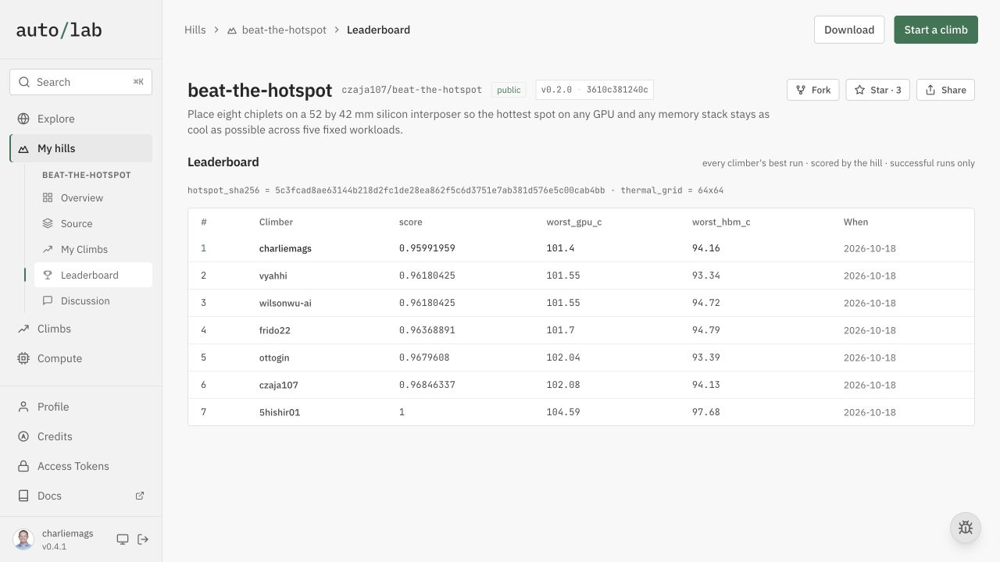
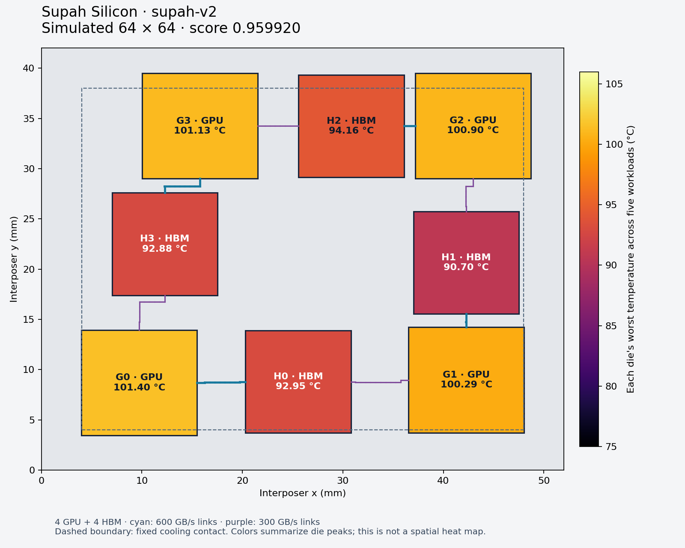
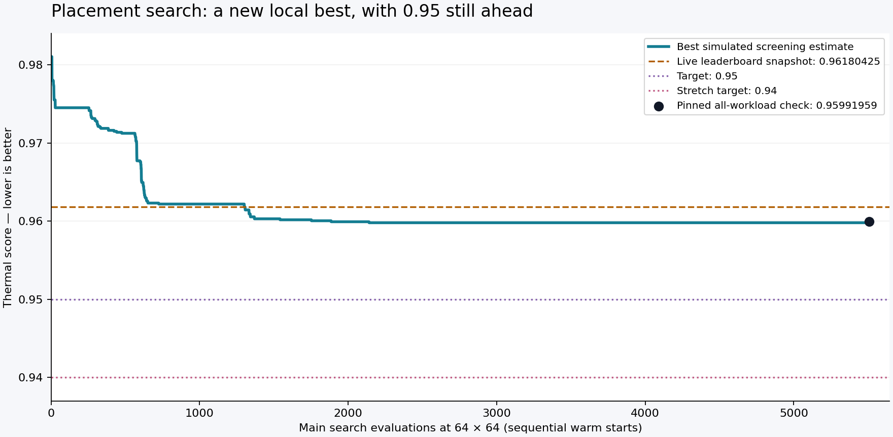

# Supah Silicon v2

**Official AutoLab 64-grid score: 0.95991959. Ranked #1 as charliemags**
on the October 18, 2026 leaderboard snapshot. This beats the next-best score,
**0.96180425**, by
**0.00188466** (0.196%).
The **0.95 and 0.94 targets were not reached**. The signed 64-grid result
matches local verification exactly; the 128-grid result remains local verification.

The [official report](official-report-64.json) was produced at 20:22:27 UTC
on October 18 by the pinned AutoLab hill, version `3610c381240c`, on rented
CPU compute. [View the successful run](https://app.autolab.ai/projects/charliemags/supah-silicon-v2-verified-095991959/jobs/af03db90-7f0b-4b37-a53b-be12bddd4232).
The report records `official: true`, `passed: true`, all five workloads and
the platform's HMAC signature. It is preserved unchanged apart from JSON formatting.



| Mesh | Design | Score ↓ | GPU peak | HBM peak |
|---|---|---:|---:|---:|
| 64 × 64 | Supah v1 | 0.98115341 | 103.09 °C | 95.56 °C |
| 64 × 64 | Previous leader snapshot | 0.96180425 | 101.55 °C | 94.72 °C |
| 64 × 64 | **Supah v2** | **0.95991959** | **101.40 °C** | **94.16 °C** |
| 128 × 128 | Supah v1 | 0.98106346 | 103.23 °C | 95.61 °C |
| 128 × 128 | **Supah v2** | **0.96200150** | **101.71 °C** | **94.24 °C** |

The official report and both local reports run all five workloads with the unmodified organizer judge
and the pinned HotSpot binary. The benchmark reference is specific to each
mesh; compare leaderboard positions at 64, not across resolutions.
The [pre-submission snapshot](search/leaderboard-refreshed.json) and
[official-run snapshot](search/leaderboard-official.json) record the source
and observed scores. See the [live leaderboard](https://app.autolab.ai/hills/czaja107/beat-the-hotspot/leaderboard)
for subsequent changes.



The colors show each die's maximum across five workloads, not a simultaneous
spatial heat map. The dashed rectangle is the fixed cooling contact.

## Optimization method

The strongest tested combination was **native HotSpot/SuperLU simulation,
additive Matérn Gaussian-process guidance, then parallel tempered placement
search**. Per-die predictions preserve changes in which die is hottest.
Connected-group moves and differential directions explore the tight routing
constraints. A constrained projection survey and 36 legal
arrangements and 42 translation cases were also tested. These sequential experiments use warm starts
and different budgets; they do not establish a universally best algorithm.

The native direct solver generates search estimates only. Final scores come
from the pinned binary, which differed by 0.01 °C for the selected design. Neither solver substitutes
a learned prediction for the reported score. The search screened three
critical workloads, followed by all-five-workload verification of finalists.

This record contains **5518 screening evaluations at 64** and
**17 at 128**, plus separate finalist checks. The expanded search
used four concurrent layouts and twelve annealing walkers; the wider search
used sixteen walkers and a higher acceptance temperature. Docker reported
18 CPUs, about 16 GB RAM, and 2 GB VM swap. The search container allowed
12 CPUs and 8 GB RAM. The wider run's 10 GB combined memory/swap cap allows
up to 2 GB swap; actual observed runs remained CPU-bound with no swap pressure.
See [runtime metadata](search/runtime.json) and the [method guide](../../docs/08-surrogate-search.md).

## What changed in the chip

Only positions and automatically generated routes changed. All eight dies,
orientations, power maps, material properties, cooling contact, and required
link bandwidths are fixed. The selected layout passes the exact geometry,
port-capacity, and routing checks. Its bandwidth-weighted route length is
**13444.8 / 13500 GB/s·mm**.

The remaining 0.95 target requires GPU ≤100.61 °C and HBM ≤94.04 °C with the
judge's two-decimal temperatures at 64. The selected design still needs about
**0.79 °C GPU** and **0.11 °C HBM** improvement.
For 0.94 the corresponding limits are 99.81 °C and 93.31 °C. Search plateaus
are not proof that these targets are impossible.

## Verified workloads at 64

| Workload | GPU peak | HBM peak | Modeled package power |
|---|---:|---:|---:|
| tensor_training | 101.13 °C | 84.44 °C | 403.337 W |
| skewed_compute | 101.40 °C | 78.39 °C | 346.021 W |
| attention_decode | 83.72 °C | 76.84 °C | 323.392 W |
| memory_stream | 93.52 °C | 94.16 °C | 395.139 W |
| mixed_serving | 91.37 °C | 78.75 °C | 351.675 W |

These are synthetic steady-state thermal results and modeled package watts,
not measurements of manufactured silicon or application energy efficiency.

## Search evidence

| Run | Grid | Evaluations | Best screening score ↓ |
|---|---:|---:|---:|
| anneal-native-1 | 64 | 160 | 0.97449428 |
| bayes-native-1 | 64 | 160 | 0.97210705 |
| bayes-native-2 | 64 | 240 | 0.97122754 |
| bayes-additive-1 | 64 | 160 | 0.96230682 |
| polish-native-1 | 64 | 400 | 0.96218118 |
| polish-g0 | 64 | 180 | 0.96218118 |
| bayes-additive-2 | 64 | 240 | 0.96029652 |
| bayes-per-die | 64 | 200 | 0.96017088 |
| population-expanded | 64 | 1600 | 0.95979394 |
| project-g0 | 64 | 66 | 0.96017088 |
| project-h3 | 64 | 24 | 0.96017088 |
| topology | 64 | 36 | 0.96017088 |
| project-g0-128 | 128 | 17 | 0.96162528 |
| population-wide | 64 | 2000 | 0.95979394 |
| translation-sweep | 64 | 42 | 0.95979394 |



The small historical sweeps are included in the total above. Logs, candidate
submissions, manifests, solver calibration, and frozen optimizer sources are
in [search/](search/). Early variants evolved during exploration; their logs
record observations, while the archived final source supports future searches.
[selection.json](selection.json) records the primary selection and exact hash.

## Reproduce

From the repository root, with Docker running:

```sh
./simulation/run setup
./simulation/run setup-search
./simulation/run test-native
./simulation/run validate simulation/layouts/supah-v2/submission.json
./simulation/run score simulation/layouts/supah-v2/submission.json --grid 64 --output simulation/results/supah-v2-64.json
./simulation/run score simulation/layouts/supah-v2/submission.json --grid 128 --output simulation/results/supah-v2-128.json
```

The selected submission is [submission.json](submission.json); its exact
verification reports are [64 grid](verification-64.json) and
[128 grid](verification-128.json). The native test suite passed 13 checks,
including held-out GP predictions, per-die outputs, history filtering,
projection legality, routing integrity, and HBM-sensitive scoring.
