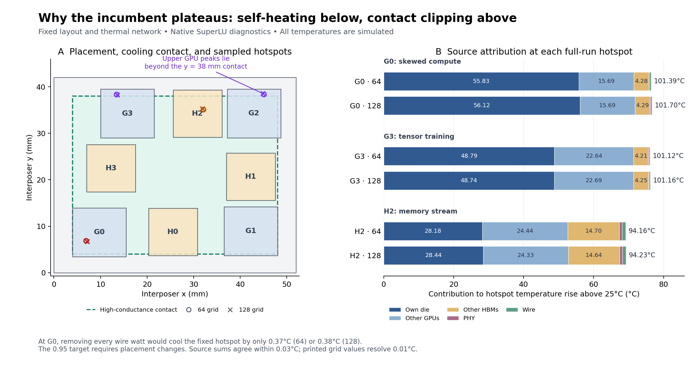

# Placement research v3: measured limits and a small HBM improvement

**Neither 0.95 nor 0.94 was achieved. No lower primary score was found.**
This investigation tested new package arrangements, coordinated minimax moves,
optional routes and thermal source attribution. The best verified candidate
ties the incumbent at 64 while reducing its HBM peak. This is a small secondary
improvement, not the requested substantial leaderboard breakthrough.

The incumbent directory, submission, signed report and both verification
reports remain unchanged. [The integrity audit](lead/audit.json) checks their
hashes against the [start-of-session manifest](lead/session.json).
All experiments used local CPU containers with networking disabled. No paid
compute was provisioned, and AutoLab received no access to the Mac's Docker
socket. No new official report or leaderboard submission was produced.

## Best verified candidate and comparison

The candidate is [submission.json](lead/finalists/control-hbm/submission.json).
Its exact SHA-256 is:

```text
9ab467d65809f0089735eb6d9646f6e351cda541e66705f9f812a3481ff65ba9
```

| Grid | Design | Pinned score | GPU maximum °C | HBM maximum °C |
|---|---|---:|---:|---:|
| 64 | Immutable v2 incumbent | 0.95991959 | 101.40 | 94.16 |
| 64 | New HBM candidate | 0.95991959 | 101.40 | 94.08 |
| 128 | Immutable v2 incumbent | 0.96200150 | 101.71 | 94.24 |
| 128 | New HBM candidate | 0.96200150 | 101.71 | 94.19 |

The [64 report](lead/finalists/control-hbm/verification-64.json) is from the
unchanged pinned judge, all five workloads, with exact organizer validation.
The [128 report](lead/finalists/control-hbm/verification-128.json) is a separate
same-grid check; the reference temperatures differ across grids. Local reports
are not signed AutoLab reports. The original signed incumbent remains the
official result of record.

Both reports passed all five workloads and exact organizer validation. The
HBM gain is 0.08 °C at 64 and 0.05 °C at 128; the primary score and maximum
GPU temperature tie the incumbent at each grid. The accepted weighted route
length is 13,481.7 / 13,500 GB/s·mm. This is the selected **fully verified**
candidate, not a claim that every tied screening candidate was certified.

The refreshed [live leaderboard](https://app.autolab.ai/hills/czaja107/beat-the-hotspot/leaderboard)
at the recorded [October 18 recheck](lead/leaderboard-final.json) shows zaiba6 and
vyahhi at 0.95979394, and charliemags **third at 0.95991959**. The leading GPU
temperature is 101.39 °C; their respective HBM peaks are 94.15 and 94.71 °C.
The native search solver also prints 101.39 °C for our unchanged incumbent,
but its pinned result is 101.40 °C. That native number must never be used to
claim a tie with the signed leaders.

## Why this candidate helps, and why it does not solve the objective

Only H2 and H3 move relative to v2: H2 moves 0.045 mm north, from y=29.146 to
29.191; H3 moves 0.012 mm south, from y=17.398 to 17.386. The rest of the
placement and all hardware remain fixed; routes are automatic. H2's peak is
the memory-stream bottleneck. These changes lower that peak without changing
G0's rounded worst GPU temperature. This measured local effect is consistent
with changes in coupling and grid deposition; their separate contributions
were not isolated. It is not evidence of a new package architecture.
The memory-stream package power actually rises slightly, from 395.139423 to
395.161005 W, so the benefit is not simply lower total power.

G0 under skewed compute still sets the score. At 64, the 0.95 target requires
GPU ≤100.61 °C and HBM ≤94.04 °C at the judge's two-decimal precision. The
candidate therefore still needs 0.79 °C of GPU cooling and 0.04 °C of HBM cooling.
For 0.94, the corresponding limits are 99.81 and 93.31 °C.

## Reconstructing the incumbent's thermal limit



At 64, G0/skewed reaches 101.40 °C in the pinned solver. G3/tensor reaches
101.13 °C, G2/tensor 100.90 °C, and G2/skewed 100.85 °C. All must cool to
meet 0.95; cooling G0 alone is insufficient. H2/memory reaches 94.16 °C.

The native solver's actual G0 hotspot is (6.90625, 6.890625) mm at 64 and
(7.109375, 6.7265625) mm at 128. Its 64-grid temperature rise comprises:

| Source | Rise at the G0 hotspot, °C |
|---|---:|
| G0 base activity | 55.83 |
| Other GPU base activity | 15.69 |
| HBM base activity | 4.28 |
| PHY/interface additions | 0.23 |
| Wire additions | 0.37 |

These are independent linear source solves with the **same fixed conductivity
network**, summed at the original full-run hotspot. Source sums reconstruct
the full grid within 0.03 °C at 64 and 0.02 °C at 128, consistent with rounded
solver output. Altered-source cases are diagnostics, never challenge scores.

G2 and G3 tensor hotspots lie beyond the good-contact boundary y=38 mm at
both grids. Moving them south can cool those dies strongly, but does not
directly remove G0's limiting self-heating. G0's 64→128 temperature difference
is mostly its own-source contribution (55.83→56.12 °C), indicating substantial
self-heating/rasterization sensitivity. H2 is much more coupling-sensitive:
G2 and G3 contribute 9.54 and 7.68 °C at its 64-grid memory hotspot.

[Physics report](physics/README.md) contains the full attribution, hotspot
locations, cooling-boundary interpretation and falsification conditions.

## Constraint structure and what changed in the search

The incumbent's remaining reach is only 0.002 mm on S1, 0.014 mm on S0,
0.051 mm on P3 and 0.096 mm on P0. Its weighted route budget has 55.2
GB/s·mm remaining. Track access can change after movements of only 2–15 μm,
so continuous Manhattan distance alone is an inadequate constraint model.

The first epigraph method used per-workload/per-die responses and a shared
normalized upper bound, but its fixed-overhead route approximation rejected
all fitted proposals. A corrected model fixes each route's track cells,
uses exact port-to-track access lengths, constrains endpoint cell membership,
preserves facing sides and keeps path points outside expanded die boxes.
It produced 48 thermal-tested epigraph proposals; 43 of 48 unbacktracked
optima passed exact validation. The remaining five were backtracked.

Correct geometry exposed a second problem: the local linear thermal models
overpredicted gains by 0.001906 score on average, approximately 0.152 °C in
GPU-rise units. The fixed-radius experiment is not a converged trust-region
algorithm. A future model should adapt its radius using actual versus
predicted reduction and explicitly model local curvature/grid phase.
No analytic adjoint was used: the wrapper does not expose K or its
factorization, and ignoring geometry-dependent conductance would be unsafe.

The [math report](math/REPORT.md) gives the minimax formulation, sensitivity
measurements, model audit and the limits of any bound. The [packaging report](packaging/REPORT.md)
documents exact geometry, ports, routes and candidate families.

## Hypotheses tested

| Hypothesis / experiment | Actual evaluations | Measured outcome |
|---|---:|---|
| Existing population search, incumbent seed | 256 | Best native score unchanged at 0.95979394; selected HBM candidate found |
| Component epigraph plus feasible fallback | 256 including first 91 | Same best score; original epigraph route approximation failed exact validation |
| Corrected fixed-route epigraph | 64 additional | 48 epigraph trials, 16 fallback; no lower native score |
| Genuinely different 4×2 cycle packings | 64 | Best GPU/HBM 108.57/101.50 °C; rejected |
| Inverted rings, GPUs at side midpoints | 48 | Best 106.99/90.75 °C; memory improved but GPU worsened |
| Wider inverted rings | 32 | Best 105.82/90.71 °C; expansion is route-budget limited |
| Asymmetric refinement of best initial inverted ring | 256 | Best score 1.00251288; improved its seed but remained much worse than incumbent |
| Equal-length route alternatives | 23 | No improvement; limiting GPU 101.39–101.40 °C |
| Exact-valid directed H3 isolation moves | 12 | Best 101.42/94.08 °C; larger moves heated G3 to 105.58 °C |
| Controlled connected-group coupling sweep | 13 of 73 proposals valid | Bringing neighboring groups inward worsened G0; no primary gain |

There is one additional incumbent control in the packaging experiment. Thus
these searches comprise **1,025 candidate evaluations** before robustness
checks, including repeated controls but excluding inherited-history duplicates
and 70 source-diagnostic solves. Counts are reconstructed in [audit.json](lead/audit.json).
The two incumbent-based 256-evaluation comparisons use equal actual budgets,
but a single run per method is not a statistical algorithm ranking. The extra
64 epigraph tests and alternative-topology refinement are separate experiments.
All packaging and coupling screens run all five workloads; the two incumbent
optimizers screen three workloads and finalists run all five.

## Bounds and uncertainty

At fixed incumbent geometry, removing every wire source could reduce G0's
64-grid hotspot by only 0.37 °C, leaving approximately 101.02 °C at that
point. Therefore route changes alone cannot reach 0.95 at this placement.
Moreover, every longer grid path adds at least 1 mm (path-length parity),
costing at least 300 GB/s·mm. The remaining 55.2 budget prohibits such a
detour. Equal-length paths are the only fixed-placement routing freedom.

Neither result is a global placement bound. Moving dies changes K, source
deposition, available routes and peak identity. A heuristic common-sink
relaxation gives about 100.19 °C for G0, but some source contributions lie
below the assumed 0.08 K/W common rise, so that estimate is **not a rigorous
floor**. No proof of infeasibility for 0.95 or 0.94 was obtained.

Calibration against the stored pinned incumbent covers 40 die/workload peaks
at each grid, with maximum absolute native/pinned discrepancy 0.01 °C.
[Native-solver perturbation records](lead/robustness-control-hbm/results.jsonl) test
±0.005 and ±0.025 mm single-die and whole-layout movements, exact-validate
each proposal, and run every legal case across all five workloads at 64/128.
Their ranges and completion count are in [the audit](lead/audit.json). Invalid
directions are retained as constraint evidence. Robustness here concerns the
benchmark's placement and grid sensitivity, not manufacturing tolerances.

The completed survey contains 73 proposals: 50 exact-valid cases (including
the unperturbed candidate), each run at both grids, and 23 rejected proposals.
Across the 49 legal perturbations, native GPU/HBM ranges are
101.39–101.44 / 94.06–94.14 °C at 64 and
101.69–101.72 / 94.17–94.22 °C at 128. Every tested legal perturbation retained
some HBM improvement relative to the same-grid native incumbent (94.16/94.23),
but none lowered the 64-grid primary score. A whole-layout southward shift of
0.025 mm improved native 128 GPU by 0.01 °C while worsening HBM; it is retained
as a tradeoff, not a newly certified finalist. These 100 two-grid candidate
evaluations took 657.1 seconds and are additional to the 1,025 search evaluations.

## Reproduction

Use the existing local images built by `simulation/run setup` and
`simulation/run setup-search`. The research launcher checks the unchanged
pinned challenge revision and mounts it read-only. It uses four CPU cores and
3 GB RAM by default. One [resource snapshot](lead/validation.json) showed
approximately 807 MiB for the native survey and 132 MiB for pinned verification;
these are observations, not peak-memory measurements. Set `SUPAH_RESEARCH_CPUS`
or `SUPAH_RESEARCH_MEMORY` only when appropriate. It never shares the Docker
socket with a container or with AutoLab.

From the repository root, choose **new output paths**:

```sh
./simulation/research-v3/run native simulation/tools/population.py \
  simulation/layouts/supah-v2/submission.json --output simulation/results/control-new \
  --evals 256 --parallel 2 --walkers 8 --radius 1.2 --temperature .003 --seed 20261018
./simulation/research-v3/run native simulation/research-v3/math/epigraph_fixed_routes.py \
  --output simulation/results/epigraph-new --additional-evals 64 \
  --history simulation/research-v3/math/epigraph-repaired-256
./simulation/research-v3/run pinned simulation/tools/evaluate.py \
  simulation/research-v3/lead/finalists/control-hbm/submission.json \
  --grid 64 --output simulation/results/recheck-64.json
./simulation/research-v3/run pinned simulation/tools/evaluate.py \
  simulation/research-v3/lead/finalists/control-hbm/submission.json \
  --grid 128 --output simulation/results/recheck-128.json
python3 simulation/research-v3/lead/audit.py
```

Specialist reports document their preparation/screening commands and source
snapshots. Raw source-attribution grids are ignored by Git and regenerable;
compact diagnostic reports, exact proposals, validation, hashes and observed
temperatures are retained. The supplied optimizer sources describe the actual
experiments, including unsuccessful methods; predictions are never promoted
to verified results.
