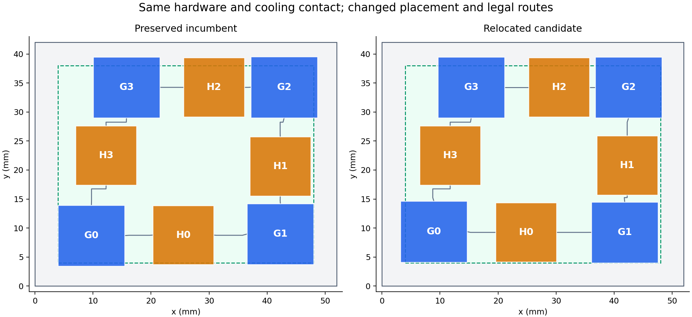

# Placement optimization results

The saved submission beats 0.95979394. The requested 0.94 target was not reached.

## Unchanged pinned evaluator, all five workloads

| Grid | Incumbent | Candidate | Change | GPU °C, old → new | HBM °C, old → new |
|---|---:|---:|---:|---:|---:|
| 64 | 0.95991959 | **0.95828622** | -0.00163337 | 101.40 → 101.27 | 94.16 → 94.27 |
| 128 | 0.96200150 | **0.96024580** | -0.00175570 | 101.71 → 101.57 | 94.24 → 94.36 |

These are local pinned verification results, not signed AutoLab submissions. Each report records the submission and evaluator hashes. Both grids use their own unchanged reference temperatures.

The GPU remains the limiting component. The memory peak increases slightly; the table records that tradeoff rather than claiming every temperature improved.

[Saved submission](submission.json) · [64-grid report](verification-64.json) · [128-grid report](verification-128.json) · [Full comparison](comparison.json) · [Integrity and search audit](audit.json)



## Search method

The main improvement came from a mixed-integer proposal model that moves dies and changes endpoint routing cells together, followed by local thermal refinement. Larger G0 relocations, ring relabelings/reflections, fine position sweeps, and legal route alternatives were tested. Every simulated layout passed the original organizer validator.

The faster native solver screens candidates. A search-only build prints eight digits instead of two in its steady temperature grid; it changes one output format string, not physics or scoring. Build provenance is in ../research-v4/precision-build.json. Only the original pinned binary supplies the scores above.

No hardware, workload, cooling, material, geometry, interconnect or scoring rules were changed. The original incumbent and 21 protected files remain byte-for-byte unchanged. Search constraints are proposal aids; the original validator remains authoritative.

At grid 64, 0.94 requires GPU ≤99.81°C and HBM ≤93.31°C at the evaluator’s output precision. The remaining gap is real; these experiments do not prove the target impossible.

## All workload peaks

| Grid | Workload | GPU °C, old → new | HBM °C, old → new |
|---|---|---:|---:|
| 64 | tensor_training | 101.13 → 101.20 | 84.44 → 85.34 |
| 64 | skewed_compute | 101.40 → 101.27 | 78.39 → 79.42 |
| 64 | attention_decode | 83.72 → 83.97 | 76.84 → 77.41 |
| 64 | memory_stream | 93.52 → 93.65 | 94.16 → 94.27 |
| 64 | mixed_serving | 91.37 → 91.49 | 78.75 → 79.27 |
| 128 | tensor_training | 101.17 → 101.29 | 85.49 → 85.72 |
| 128 | skewed_compute | 101.71 → 101.57 | 79.64 → 79.86 |
| 128 | attention_decode | 83.89 → 84.00 | 77.37 → 77.58 |
| 128 | memory_stream | 93.64 → 93.72 | 94.24 → 94.36 |
| 128 | mixed_serving | 91.47 → 91.52 | 79.20 → 79.43 |

## Evidence and reproduction

Logged candidate evaluations: 6370. Independently revalidated unique submissions: 6074. Counts include repeated controls and rescreens; see audit.json for per-experiment details.

Submission SHA-256: `e93a980c560cd10ad9b0dac238c3b06c0c61bf13aac93134207b2a3604808a49`.

```sh
./simulation/research-v3/run pinned simulation/tools/evaluate.py simulation/research-v5/submission.json --grid 64 --output simulation/results/v5-recheck-64.json
./simulation/research-v3/run pinned simulation/tools/evaluate.py simulation/research-v5/submission.json --grid 128 --output simulation/results/v5-recheck-128.json
```

All computation used local Docker with networking disabled and the challenge mounted read-only. No Docker socket was connected to AutoLab, and no compute was rented.
